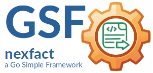

<sup>🌍 **Sprache:** 🇬🇧 [Englisch →](README.md)</sub>

---

[](https://codeberg.org/tiny-frameworks/nexfact-server)
[](https://go.dev/)
[](https://opensource.org/licenses/Apache-2.0)

| | |
|----|----|
|| ***GSF-NexFact-Server***<br>der Service Host und Anwendungs-Adapter für die **GSF-Nexfact** Invoice-Engine.|

<sup>***GSF*** steht für ***Go Small Frameworks*** — minimalistische Tools für robuste Applicationen.</sup>

---

### Repository

Das Projekt wird auf Codeberg entwickelt und gewartet.

**Canonical repository:**

> https://codeberg.org/tiny-frameworks/nexfact-server

GitHub ist ein automatisierter Mirror des Codeberg Repositories

**GitHub mirror:**

> https://github.com/tiny-frameworks/nexfact-server

---

## GSF-NexFact-Server

`GSF-Nexfact-Server` ist der Service Host und Anwendungs-Adapter für die **GSF-Nexfact** Invoice-Engine. Er stellt das Kern-Modul über verschiedene Inbound-Kanäle (P2P JSON-RPC über WebSockets sowie lokales Verzeichnis-Polling) bereit und kümmert sich um Konfiguration, Logging und Lifecycle-Management.

Das Projekt ist Teil der **tiny-frameworks** Initiative.

---

## Architecture Overview

```text
┌─────────────────────────────────────────────────────────────────────────┐
│                           nexfact-server                                │
│                                                                         │
│   ┌───────────────────────────┐         ┌────────────────────────────┐  │
│   │   P2P / RPC Adapter       │         │  Directory Watcher Adapter │  │
│   │ (OrchestratorDelegate)    │         │   (Input-Folder Polling)   │  │
│   └─────────────┬─────────────┘         └──────────────┬─────────────┘  │
│                 │                                      │                │
│                 └──────────────────┬───────────────────┘                │
│                                    │                                    │
│                                    ▼                                    │
│   ┌─────────────────────────────────────────────────────────────────┐   │
│   │                         nexfact Core                            │   │
│   │                   (orchestrator.Orchestrator)                   │   │
│   └─────────────────────────────────────────────────────────────────┘   │
└─────────────────────────────────────────────────────────────────────────┘

```

* **P2P WebSocket RPC:** Ermöglicht die synchrone Rechnungsverarbeitung über das `nexutils/p2p/rpc`-Protokoll (z. B. für Pharo Smalltalk via `nexutils-st` oder Go-Peers).
* **Directory Watcher:** Überwacht ein konfigurierbares Eingangsverzeichnis atomar auf `.json`-Aufträge für automatisierte Batch-Verarbeitungen.
* **Graceful Shutdown:** Garantiert bei OS-Signalen (`SIGINT`, `SIGTERM`), dass laufende Jobs vollständig beendet und Verzeichnisse sauber hinterlassen werden.

---

## Directory Structure

```text
nexfact-server/
├── cmd/
│   └── nexfact-server/
│       └── main.go          # Application Entrypoint & Signal Handling
├── internal/
│   ├── config/              # 3-Stage Configuration Management
│   ├── p2p/                 # P2P JSON-RPC Delegate & Adapter
│   ├── server/              # Lifecycle Manager (P2P Node + Watcher)
│   └── watcher/             # Atomic Directory Watcher
├── config.json.example      # Sample configuration file
├── go.mod
└── README.md

```

---

## Configuration (3-Stage Precedence)

Die Konfiguration erfolgt nach einem 3-stufigen Hierarchie-Modell (**Höchste Priorität überschreibt niedrigere**):

1. **Environment Variables** (Höchste Priorität)
2. **Configuration File** (`config.json`)
3. **Defaults** (Harte Standardwerte im Code)

### Environment Variables

| Variable | Default | Description |
| --- | --- | --- |
| `NEXFACT_ENV_DIR` | `./env` | Pfad zum nexfact Environment-Verzeichnis |
| `NEXFACT_RPC_ADDR` | `:9090` | Listen-Adresse für den P2P WebSocket RPC Server |
| `NEXFACT_HEARTBEAT_INT` | `30s` | Intervall für P2P Peer Heartbeats |
| `NEXFACT_WATCH_DIR` | `./data/input` | Eingangsordner für den Directory Watcher |
| `NEXFACT_PROCESSED_DIR` | `./data/processed` | Zielordner für erfolgreich verarbeitete Jobs |
| `NEXFACT_ERROR_DIR` | `./data/error` | Zielordner für fehlgeschlagene Jobs |
| `NEXFACT_POLL_INT` | `2s` | Abfrageintervall des Directory Watchers |
| `NEXFACT_LOG_LEVEL` | `info` | Log-Level (`debug`, `info`, `warn`, `error`) |

### Configuration File (`config.json`)

Optional kann beim Start eine `config.json` übergeben oder im Arbeitsverzeichnis hinterlegt werden:

```json
{
  "env_dir": "/var/lib/nexfact/env",
  "rpc_addr": "0.0.0.0:9090",
  "heartbeat_interval": "30s",
  "watch_dir": "./data/input",
  "processed_dir": "./data/processed",
  "error_dir": "./data/error",
  "poll_interval": "2s",
  "logger": {
    "level": "info"
  }
}

```

---

## Getting Started

### Prerequisites

* **Go:** 1.26.0 oder neuer
* **Workspace:** Empfohlen im Multi-Module Workspace via `go.work` zusammen mit `nexfact` und `nexutils`.

### Building & Running

**Lokal bauen:**

```bash
go build -o bin/nexfact-server ./cmd/nexfact-server

```

**Starten mit Standard-Konfiguration:**

```bash
./bin/nexfact-server

```

**Starten mit explizitem Config-File:**

```bash
./bin/nexfact-server -config /path/to/config.json

```

---

## Testing

Die Test-Suite nutzt isolierte Temp-Ordner und dynamische Ports:

```bash
# Alle Tests inklusive Race-Detector ausführen
go test -v -race ./...

```

Für lokale Multi-Module Tests empfiehlt sich eine `go.work`-Datei im übergeordneten Verzeichnis:

```go
go 1.26.0

use (
	./nexfact
	./nexfact-server
	./nexutils
)

```

---

## License

Copyright (c) 2026 Georg Hagn.

Lizenziert unter der **Apache License 2.0**.

---
